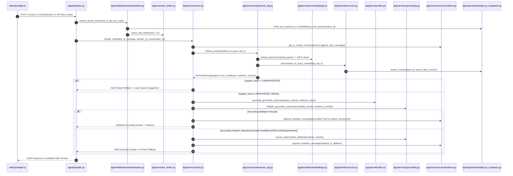
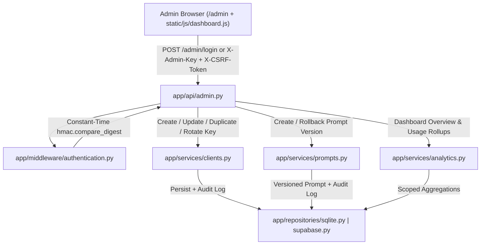
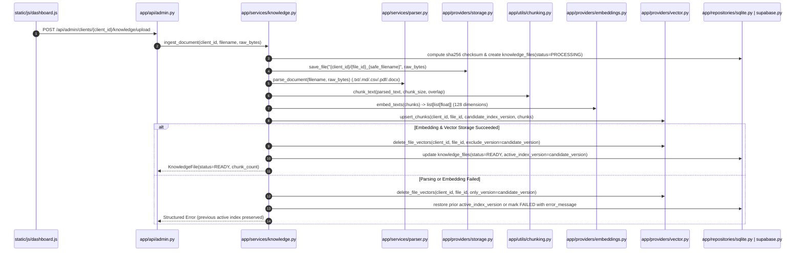
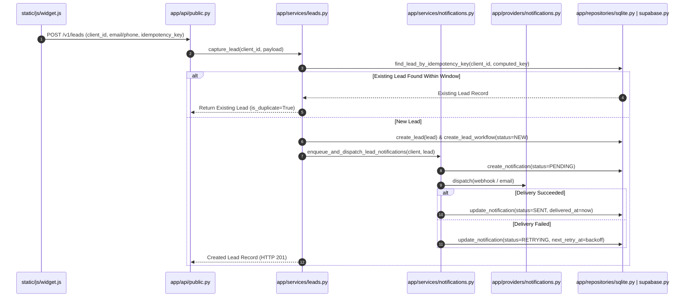

# Orbit AI — System Architecture & Data Flows

Orbit AI is architected with clean layered boundaries separating HTTP transport (`app/api/`), authentication & request middleware (`app/middleware/`), business orchestration services (`app/services/`), pluggable infrastructure providers (`app/providers/`), and persistence repositories (`app/repositories/`).

---

## 1. End-to-End Customer Chat & Grounded RAG Flow

When a customer sends a message from `static/js/widget.js` to `/v1/chat` or `/v1/chat/stream`, the request traverses tenant authentication, domain allowlist validation, rate limiting, hybrid retrieval, LLM generation, and deterministic post-generation grounding validation before any answer reaches the browser.

---

## 2. Admin Control Center & Configuration Flow

Administrators authenticate via `X-Admin-Key` or an `HttpOnly` HMAC-signed session cookie at `/admin/login`. Every state-changing browser action validates a CSRF token (`X-CSRF-Token`) and writes an immutable entry to `audit_logs`.

---

## 3. Safe Versioned Knowledge Upload & Re-Indexing Flow

Uploading or re-indexing a knowledge document never leaves a tenant with an empty or half-written vector index. Chunks are staged under a candidate `index_version` and promoted only after all embeddings are verified.

---

## 4. Idempotent Lead Capture & Outbox Notification Flow

Lead capture is decoupled from external notification delivery so a transient webhook or email outage never loses a customer lead or causes duplicate rows.

